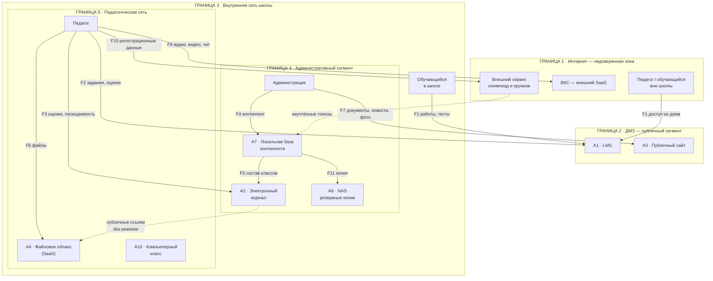
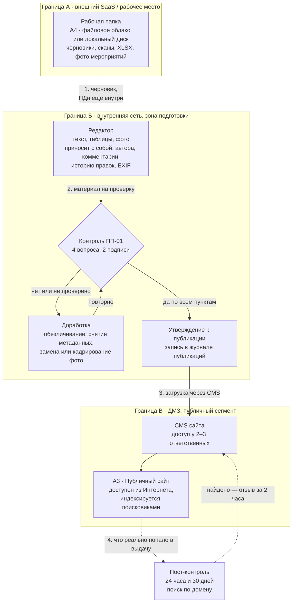
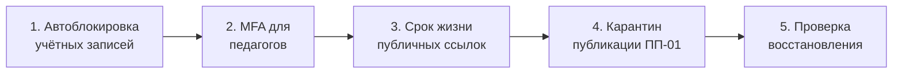

# ПР1. Моделирование угроз цифровой образовательной среды

## 1. Пять критичных активов
| Актив | Что защищаем | Критичное свойство | Почему важен |
|---|---|---|---|
| **A2 · Электронный журнал** | Оценки, посещаемость, идентификаторы обучающихся | **Целостность** (в первую очередь), затем конфиденциальность | Юридически значимый документ успеваемости: на нём строятся текущая и итоговая аттестация, отчётность, льготы, перевод в следующий класс. Ошибка или подмена оценки не исправляется технически — она порождает конфликт с родителями и претензии при проверке. К журналу привязаны ПДн 850 детей. |
| **A7 · Локальная база контингента** | ФИО, класс, статус обучения несовершеннолетних | **Конфиденциальность** + целостность | Первичный источник ПДн, из которого наполняются остальные системы (F5). Утечка базы — утечка данных всех 850 семей сразу, с последствиями по 152-ФЗ. Искажение состава классов ломает расписание, питание, деление на группы, отчётность. |
| **A4 · Файловое облако** | Учебные и рабочие документы, часто с ПДн внутри | **Конфиденциальность** | Самая вероятная точка реальной утечки: публичные ссылки создаются массово педагогами, ревизия старых ссылок не проводится. Документ, открытый «на неделю», остаётся доступен годами и индексируется. Здесь же риск потери рабочих материалов при увольнениях и сбоях. |
| **A1 · LMS** | Учебные материалы, работы, тесты, результаты | **Доступность** на время занятий и аттестации + целостность результатов | Единственная система, доступная из Интернета и одновременно несущая учебный процесс, в том числе дистанционный. Простой LMS останавливает занятие целиком, а компрометация учётных записей педагогов (MFA не обязательна) даёт массовую подмену работ и результатов. |
| **A11 · Учётные записи и права доступа** *(добавленный актив)* | Учётные записи педагогов, администраторов, интеграционные токены | **Конфиденциальность + целостность** (выдача себя за другого) | «Ключ» ко всем остальным активам. Ручная блокировка при увольнении означает, что действующая учётная запись бывшего сотрудника — вопрос времени, а не вероятности. Без перечня токенов нет понимания, кто ещё имеет доступ к данным. |

## 2. Схема цифровой среды

## 3. Реестр пяти рисков
| ID | Актив | Сценарий риска | P | I | R | Меры защиты | Остаточный риск |
|---|---|---|---|---|---|---|---|
| **R1** | A2 · Электронный журнал | Уволенный педагог → ручная блокировка учётной записи с задержкой → компрометация учётной записи → массовое искажение оценок и посещаемости за четверть | 4 | 5 | **20** | 1. Автоматическая блокировка учётных записей при внесении записи об увольнении в базу контингента (A7). 2. Синхронизация кадровой системы с AD/IdP раз в сутки. 3. Ежемесячный аудит активных учётных записей против актуального списка сотрудников. 4. Логирование всех изменений оценок с уведомлением администратору в реальном времени. 5. Обязательная MFA для педагогов с доступом к журналу. | P=2, I=4 **R=8** |
| **R2** | A7 · Локальная база контингента | Внешний злоумышленник или инсайдер → уязвимость административного сегмента → утечка полной базы контингента → публикация ПДн 850 обучающихся, санкции надзора | 3 | 5 | **15** | 1. Сегментация административной сети на уровне L3, запрет прямого доступа из педагогического сегмента. 2. Белый список IP для доступа к базе + VPN с сертификатами для удалённого доступа. 3. Шифрование базы на уровне СУБД и полнодисковое шифрование сервера. 4. IDS/IPS на границе административного сегмента. 5. Ежеквартальный внешний пентест. 6. DLP на периметре для блокировки массовой выгрузки. | P=1, I=5 **R=5** |
| **R3** | A4 · Файловое облако | Педагог → создание публичной ссылки на документ с ПДн «временно» → отсутствие ревизии ссылок → публичный доступ годами, индексация поисковиками | 5 | 4 | **20** | 1. Запрет публичных ссылок без срока действия; максимум 7 дней с автоматической деактивацией. 2. Еженедельный автoаудит активных ссылок с уведомлением владельца за 24 часа до истечения. 3. Обучение альтернативам: общая папка с правами по учётной записи, одноразовая ссылка с паролем. 4. DLP: сканирование документа перед созданием публичной ссылки на паттерны ПДн. 5. Принудительная ревизия всех ссылок старше 30 дней. | P=2, I=3 **R=6** |
| **R4** | A1 · LMS A11 · Учётные записи | Фишинговая рассылка на корпоративную почту → отсутствие обязательной MFA у педагогов → компрометация учётной записи LMS → доступ к работам и результатам, подмена материалов и оценок | 4 | 4 | **16** | 1. Обязательная MFA для всех пользователей LMS. 2. Уведомление о каждом входе с незнакомого устройства. 3. Блокировка после 3 неудачных попыток на 15 минут. 4. Обучение распознаванию фишинга раз в полгода и симуляционные рассылки. 5. Email-шлюз с песочницей для вложений и проверкой ссылок. | P=2, I=4 **R=8** |
| **R5** | A8 · NAS A7 · База контингента | Сбой оборудования или шифровальщик → отсутствие проверенной процедуры восстановления (последняя проверка 8 месяцев назад) → невозможность восстановить локальную базу → потеря данных о составе классов, нарушение связей с журналом | 3 | 4 | **12** | 1. Ежеквартальная документированная проверка полного восстановления, включая целостность связей с журналом. 2. Вторая зашифрованная копия в облаке по схеме 3-2-1. 3. Мониторинг успешности ночного копирования с алертом при сбое. 4. Неизменяемые снимки на NAS с хранением 90 дней. 5. Офлайн-копия раз в месяц на внешнем носителе вне школы. | P=1, I=3 **R=3** |

| ID | Актив | P | I | R до | R после | Уровень до | Уровень после |
|---|---|---|---|---|---|---|---|
| R1 | Электронный журнал | 4 | 5 | 20 | 8 | критический | умеренный |
| R3 | Файловое облако | 5 | 4 | 20 | 6 | критический | умеренный |
| R4 | LMS, учётные записи | 4 | 4 | 16 | 8 | высокий | умеренный |
| R2 | Локальная база | 3 | 5 | 15 | 5 | высокий | умеренный |
| R5 | NAS, база контингента | 3 | 4 | 12 | 3 | высокий | низкий |

### Обоснование риска R1 
· Компрометация журнала через учётную запись уволенного педагога (R = 20)
**Почему P = 4 и I = 5.** Блокировка выполняется вручную, а человеческий фактор — это не «если», а «когда»: кадровик забыл, системный администратор в отпуске, увольнение оформлено задним числом. При 62 педагогах и текучести кадров в образовании порядка 10–15 % в год это 6–9 увольнений ежегодно, и достаточно одного пропущенного случая. Влияние критическое, потому что журнал — юридически значимый документ успеваемости: массовое искажение оценок в конце четверти или года порождает конфликты с родителями, делает невозможной аттестацию, требует ручного восстановления по бумажным ведомостям, которых может не быть, и ставит под угрозу перевод в следующий класс и выдачу документов об образовании.
**Почему меры снижают риск.** Автоматическая блокировка убирает человеческий фактор: запись об увольнении в базе A7 запускает деактивацию в течение часа, а не «когда вспомнят». Ежемесячный аудит ловит аномалии — давно не работающий педагог с активной учётной записью. MFA и логирование изменений с алертами дают второй эшелон: даже при активной учётной записи нужен доступ к телефону педагога, а попытка массовой правки оценок вызывает немедленное уведомление. Вероятность падает до P = 2 — только при одновременном отказе всех эшелонов; влияние до I = 4, поскольку инцидент детектируется быстро и объём изменений ограничен.
**Чем опасен для образовательного процесса.** Искажение оценок ломает доверие всей системы аттестации. Родители не понимают, чьи оценки верны, педагоги не могут доказать исходные значения, администрация пересчитывает вручную сотни записей. В период итоговой аттестации это останавливает выдачу документов об образовании. Плюс репутационный удар: «школа потеряла контроль над оценками» ведёт к переводу детей и усилению проверок.

#### Обоснование риска R3 · Утечка ПДн через забытые публичные ссылки (R = 20)
**Почему P = 5 и I = 4.** Публичные ссылки создаются, а ревизия не проводится: 62 педагога по 5–10 ссылок в год дают сотни ссылок за несколько лет. Достаточно одной ссылки на список класса с ФИО и контактами. Поисковые системы индексируют общедоступные облачные документы, и «временная» ссылка через год находится через поиск. Влияние серьёзное, но не критическое: утечка одного документа с 25–30 детьми — это нарушение 152-ФЗ, уведомление надзору, проверка, штрафы и репутационный ущерб, но не компрометация всей базы.
**Почему меры снижают риск.** Автоматическая деактивация через 7 дней сокращает окно уязвимости и снижает вероятность индексации — поисковый робот обходит сайты раз в несколько дней или недель. DLP-сканирование перед созданием ссылки блокирует публикацию документов с явными паттернами ПДн. Обучение даёт альтернативы: общая папка с правами доступа вместо публичной ссылки. Ревизия каждые 30 дней закрывает хвосты. Вероятность падает до P = 2, влияние остаётся I = 3: если утечка произойдёт, объём ограничен одним документом, а не архивом.
**Чем опасен для образовательного процесса.** Утечка ПДн подрывает доверие родителей и ограничивает использование цифровых инструментов. После инцидента родители массово отзывают согласия, педагоги возвращаются к бумажным носителям и передаче файлов на USB, что замедляет работу. Надзор может временно запретить облако до устранения нарушений. В худшем случае данные попадают к мошенникам — звонки родителям от имени школы, целевой фишинг, — что вызывает скандал и отток обучающихся.

## 4. Индивидуальный вариант № 5
### Задание 1
| ID | Актив | Сценарий риска | P | I | R | Меры защиты | Остаточный риск |
|---|---|---|---|---|---|---|---|
| **R6** | **A3 · Публичный сайт** *(источник данных — A4 · файловое облако)* | Сотрудник → подготовка материала в рабочей папке без обезличивания → публикация через CMS файла или фото с ПДн обучающихся → открытый доступ из Интернета, индексация, утечка ПДн несовершеннолетних | 4 | 4 | **16** | 1. Карантин публикации: ни один файл не попадает в CMS напрямую из рабочей папки или по почте — только через папку «На публикацию» с проверкой. 2. Правило ПП-01 с двумя подписями: автор и ответственный за публикацию. 3. Принудительное удаление метаданных при загрузке: автор, организация, комментарии, история правок, скрытые листы XLSX, EXIF с геометкой. 4. Автоматическая сверка текста и имён файлов с базой A7 — совпадение ФИО блокирует загрузку. 5. Официальные документы публикуются только в обезличенной редакции. 6. Пост-контроль через 24 часа и 30 дней, ежемесячный поиск по домену; отзыв за 2 часа. 7. Права на публикацию в CMS у 2–3 ответственных сотрудников, прямого доступа к FTP/SFTP у педагогов нет. | P=2, I=3 **R=6** |

### Задание 2
Поток «рабочая папка → редактор → сайт»

### Задание 3
> **Ни один файл не публикуется напрямую. Материал проходит четыре вопроса и две подписи.**

### Четыре вопроса

Проверяет ответственный за публикацию.

| № | Вопрос | Примеры «да» — стоп-сигнал |
|---|---|---|
| **1. Люди** | Есть ли в тексте, таблице или имени файла ФИО, класс вместе с фамилией, контакты, адрес, дата рождения, номер документа, отметка о льготе или состоянии здоровья? | «7Б, Иванов П. — инвалидность», список класса в новости |
| **2. Изображения** | Видны ли на фото лица детей крупным планом, бейджи, списки на стенах, экраны с оценками или журналом? Привязан ли кадр к конкретному ребёнку подписью? | Общее фото линейки с читаемыми лицами и подписью «наш отличник Петя» |
| **3. Файл** | Удалены ли метаданные: автор и организация, комментарии, исправления, скрытые листы и столбцы, EXIF с геометкой? | Приказ в DOCX с историей правок и именами согласующих |
| **4. Основание** | Есть ли согласие на публикацию: для фото несовершеннолетнего — письменное согласие родителя, для работы обучающегося — согласие автора? | Фото с конкурса, где согласие не собиралось |

**Если хотя бы один ответ «да» или «не проверено» — публикации нет.** Материал возвращается на доработку, а не публикуется «с пометкой на будущее».

### Две подписи

Автор материала и ответственный за публикацию — **разные люди**. Один человек не может одновременно готовить и утверждать: именно этот разрыв ловит ошибку «я же смотрел, там всё чисто».

## 5. Вывод
## Наиболее значимый риск

**R1 — компрометация электронного журнала через активную учётную запись уволенного педагога (P=4, I=5, R=20).**

Формально R3 имеет такую же оценку 20, но качество ущерба разное. Утечка через публичную ссылку ограничена одним документом, обнаруживается и локализуется. Искажение журнала необратимо: исходные значения оценок ничем не подтверждены, и восстановить «как было» часто невозможно.

### Почему это влияет именно на образовательный процесс

Журнал — единственный юридически значимый носитель результата обучения. Удар приходится в три точки одновременно:

1. **Аттестация останавливается.** Нельзя корректно выставить четвертные и годовые оценки, а значит — перевести обучающегося в следующий класс и выдать документы об образовании.
2. **Разрушается доказуемость.** Оценка без проверяемого автора и времени перестаёт быть оценкой; при конфликте с родителями школа не может доказать исходное состояние записи.
3. **Работа уходит в ручной режим.** Восстановление по бумажным ведомостям и памяти педагогов занимает недели и само порождает новые ошибки.

Дополнительно страдает доверие: родители, узнавшие, что оценки менялись, начинают сомневаться во всей отчётности школы, а не в одном эпизоде.

### Какая мера должна быть реализована первой

**Автоматическая блокировка учётной записи по событию увольнения:** кадровая запись в базе A7 → деактивация в IdP/AD в течение часа, суточная сверка плюс ежемесячный аудит активных учётных записей.

Почему именно она первая:

- **Не требует изменения привычек пользователей** — в отличие от MFA и обучения, где внедрение занимает месяцы и встречает сопротивление.
- **Закрывает самый широкий участок:** одна учётная запись даёт доступ и к журналу, и к облаку, и к LMS.
- **Дёшева и проверяема:** результат измеряется числом активных учётных записей уволенных сотрудников, целевое значение — ноль.
- **Является предпосылкой остальных мер:** аудит и MFA имеют смысл только тогда, когда список действующих учётных записей достоверен.

### Рекомендуемая последовательность

