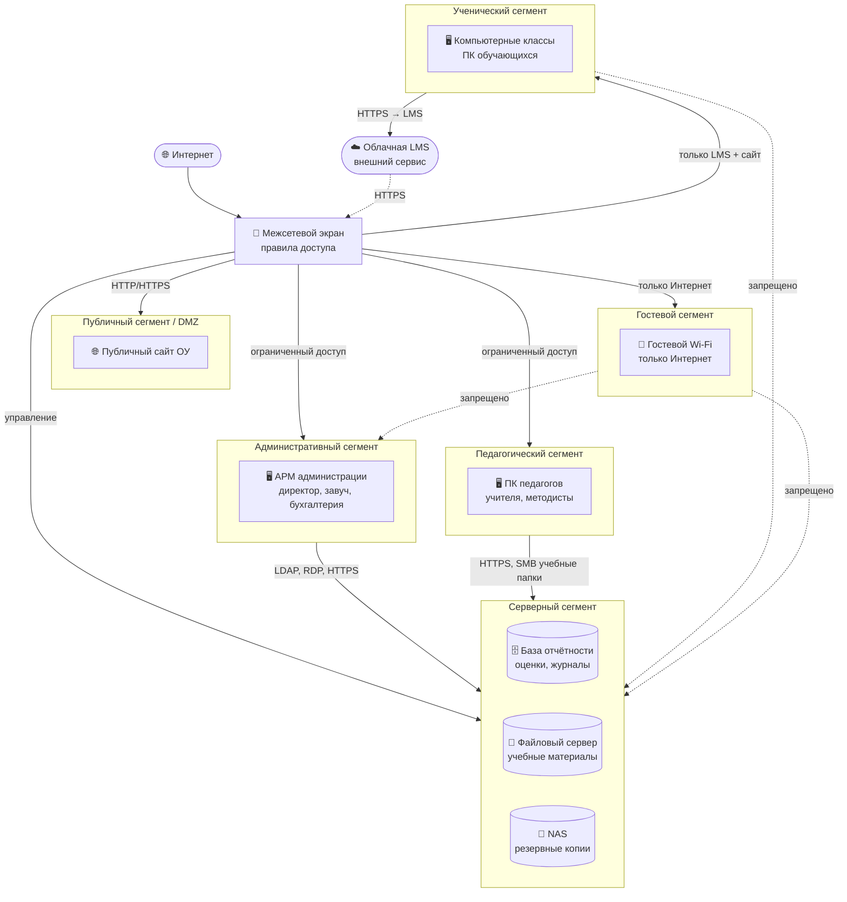

# ПР2. Проектирование защищённой инфраструктуры

## 1. Четыре риска исходной сети

| № | Проблема | Возможное событие | Что пострадает |
|---|---------|-------------------|----------------|
| 1 | Прямой доступ ученических ПК к серверному оборудованию | Скомпрометированный ПК обучающегося отправляет запросы к файловому серверу и базе отчётности → несанкционированное чтение или изменение данных об успеваемости | Конфиденциальность персональных данных обучающихся (152-ФЗ) |
| 2 | Гостевой Wi-Fi не изолирован от внутренней сети | Посетитель подключается к гостевой точке доступа и сканирует внутренний сегмент → получает доступ к NAS или базе отчётности без аутентификации | Целостность и конфиденциальность хранимых данных ОУ |
| 3 | Отсутствие барьеров для распространения вредоносного ПО (lateral movement) | Шифровальщик, попавший на ПК педагога, за минуты распространяется по всей плоской сети на серверы и резервные копии | Доступность всей инфраструктуры ОУ; данные на NAS могут быть безвозвратно утрачены |
| 4 | Административный сегмент не отделён от пользовательских ПК | ПК обучающегося обращается к АРМ администрации → компрометация ПК открывает доступ к кадровым и бухгалтерским данным | Персональные данные сотрудников, финансовая информация ОУ |

---

## 2. Защищённая архитектура



Суть решения: серверный сегмент выделен в отдельную зону, доступ в которую возможен только через межсетевой экран по явно разрешённым правилам. Ученический и гостевой сегменты не имеют маршрута к серверной зоне.

---

## 3. Шесть сетевых правил

| Источник | Назначение | Сервис / назначение | Решение | Обоснование |
|---------|-----------|---------------------|---------|-------------|
| Гостевой сегмент | Серверный сегмент | Любой протокол | **Запретить** | Гостевые устройства не аутентифицированы и не управляются ОУ; доступ к внутренним данным недопустим |
| Гостевой сегмент | Интернет | HTTP/HTTPS (80, 443) | **Разрешить** | Единственное назначение гостевого Wi-Fi — выход в Интернет для посетителей |
| Ученический сегмент | Серверный сегмент | SMB/NFS (445, 2049), прямой RDP | **Запретить** | Обучающиеся работают с LMS через браузер; прямой доступ к файловому серверу и NAS избыточен и создаёт риск утечки |
| Ученический сегмент | LMS (облако) / публичный сайт | HTTPS (443) | **Разрешить** | Обучающимся необходим доступ к образовательным ресурсам через защищённый канал |
| Административный сегмент | Серверный сегмент | HTTPS (443), LDAP (389/636), RDP (3389) только с доверенных АРМ | **Разрешить** | Администрация и ИТ-персонал управляют базой отчётности и серверами; доступ строго с фиксированных IP АРМ |
| Педагогический сегмент | Серверный сегмент | HTTPS (443) — база отчётности; SMB (445) — только учебные папки файлового сервера | **Разрешить (ограниченно)** | Педагоги ведут журнал и работают с учебными материалами; доступ к NAS, системным папкам и административным сервисам — запрещён |

---

## 4. RBAC

Обозначения: **R** — чтение, **W** — запись, **RW** — чтение и запись, **A** — администрирование, **–** — доступ отсутствует.

| Роль | LMS | Электронный журнал | Файловое облако | База отчётности | Резервные копии |
|---|:---:|:---:|:---:|:---:|:---:|
| Обучающийся | R | – | R ¹ | – | – |
| Педагог | RW | RW | RW ² | R | – |
| Методист | RW | R | RW | R | – |
| Руководитель | R | R | R | R | – |
| Системный администратор | A | A | A | A | A |

> ¹ Только папка публичных учебных материалов; личные папки педагогов недоступны.
>
> ² Только учебные папки своего класса/предмета; чужие папки недоступны.

**Два неочевидных решения:**

**Педагог → База отчётности: R, а не RW.** Педагог работает с оценками исключительно через интерфейс электронного журнала, а не напрямую с базой данных. Прямой доступ на запись позволял бы обходить бизнес-логику журнала (валидацию дат, диапазона оценок, подписей) и создавал бы риск неаудируемого изменения данных.

**Руководитель → Резервные копии: –.** Директор несёт организационную ответственность за резервное копирование, но прямой доступ к хранилищу бэкапов ему не нужен. Такой доступ создаёт риск случайного удаления архива или его компрометации. Состояние бэкапов директор получает через отчёт сисадмина.

---

## 5. Сервисные аккаунты

| Аккаунт | Лишние права | Минимально необходимые права | Интерактивный вход человека |
|---|---|---|:---:|
| `svc_backup` | Права администратора сервера: создание пользователей, изменение системных настроек, доступ к любым каталогам | Чтение из резервируемых директорий (БД, файловый сервер, NAS); запись только в целевое хранилище резервных копий | Нет |
| `svc_lms_report` | Изменение учётных записей пользователей LMS (создание, редактирование, удаление) | Только чтение отчётных данных LMS через выделенный read-only API или view в БД | Нет |
| `svc_site_sync` | Прямой доступ к базе отчётности (чтение БД с оценками и персональными данными) | Запись в папку публикации на веб-сервере; чтение только из папки одобренных к публикации материалов на файловом сервере | Нет |

---

## 6. Жизненный цикл учётных записей и MFA

**Правило 1 — где MFA обязательно**

MFA обязательно для всех учётных записей с доступом к электронному журналу, базе отчётности, файловому серверу или панели управления серверным сегментом: педагоги, методисты, руководители, системные администраторы и все сервисные аккаунты с интерактивным входом. Проверяемость: попытка входа без второго фактора должна завершаться отказом с фиксацией в журнале аутентификации.

**Правило 2 — создание новой учётной записи**

Учётная запись создаётся только при наличии подписанной заявки от непосредственного руководителя с указанием должности и требуемой роли. Системный администратор создаёт аккаунт, назначает ровно один ролевой профиль из утверждённого перечня и выдаёт временный пароль лично под подпись. При первом входе пользователь обязан сменить пароль и подключить второй фактор. Проверяемость: в системе идентификации у каждой записи должна быть ссылка на заявку.

**Правило 3 — смена прав при смене должности/роли**

В день вступления в новую должность старый набор прав полностью отзывается, новый назначается строго по роли без сохранения ранее выданных привилегий («нет накопления прав»). Заявка на смену роли оформляется тем же руководителем, что подавал заявку на создание. Проверяемость: в журнале изменений ролей должна быть запись с временной меткой, старым и новым профилем.

**Правило 4 — блокировка при увольнении/отчислении**

Учётная запись блокируется не позднее момента подписания приказа об увольнении (или в последний учебный день при отчислении). Все активные сессии завершаются принудительно, токены MFA отзываются, почтовые пересылки отключаются. Данные сохраняются согласно политике хранения под ответственностью администратора. Проверяемость: сравнение даты приказа и временной метки блокировки в AD/LDAP — расхождение более одного рабочего дня является нарушением.

**Правило 5 — восстановление доступа и подтверждение критичного изменения роли**

Восстановление заблокированной записи или повышение роли (переход в профиль с бо́льшими правами) требует письменной заявки от непосредственного руководителя и отдельного письменного согласования директора или завуча ОУ. Системный администратор не вправе самостоятельно восстанавливать доступ без двух подписей. Проверяемость: в тикет-системе должны присутствовать обе подписи до момента применения изменения.

---

## 7. RPO/RTO

| Сервис | RPO | RTO | Краткое обоснование |
|--------|-----|-----|---------------------|
| LMS | 24 часа | 4 часа | Учебные материалы и результаты работ допускают потерю за сутки: у педагогов остаются локальные копии заданий, а пропущенный день можно восстановить вручную. Полное восстановление в пределах учебного дня: сервис нужен ежедневно, но разовая пауза не блокирует учебный процесс |
| Электронный журнал | 1 час | 2 часа | Данные об успеваемости юридически значимы, оценки выставляются ежедневно и выгружаются в отчётность. Потеря более часа означает ручной перенабор текущих занятий. Восстановление за 2 часа позволяет вернуть журнал до конца рабочей смены |
| Публичный сайт | 24 часа | 8 часов | Сайт содержит новости, расписание и официальные документы, которые дублируются в других источниках и в бумажном виде. Потеря суток некритична; восстановление в течение рабочего дня достаточно |

> Значения ненулевые: ни один из сервисов ОУ не требует непрерывной работы и нулевой потери данных — это позволило бы неоправданно дорогую схему резервирования.

---

## 8. Контрольное восстановление

#### Команды:

```bash
# Размер исходного файла в байтах
stat -c%s restore_dataset.csv

# Число строк (всего, включая заголовок) исходного файла
wc -l restore_dataset.csv

# SHA-256 исходного файла
sha256sum restore_dataset.csv

# Создать копию
cp restore_dataset.csv restore_dataset_recovered.csv

# SHA-256 восстановленного файла
sha256sum restore_dataset_recovered.csv

# Число строк (всего, включая заголовок) восстановленного файла
wc -l restore_dataset_recovered.csv

# Размер восстановленного файла в байтах
stat -c%s restore_dataset_recovered.csv
```

####  Таблица для отчёта

| Параметр | `restore_dataset.csv` | `restore_dataset_recovered.csv` |
|---|---|---|
| Размер, байт | 173 | 173 |
| Число строк данных | 11 | 11 |
| SHA-256 | 2adb82f8fa5391cea7fcb493569041a0746235996d1ab58c6813673ccf517fc | 2adb82f8fa5391cea7fcb493569041a0746235996d1ab58c6813673ccf517fc |
| Итог | — | **совпадает** |

#### Вывод

Для контрольного восстановления сформирован исходный файл `restore_dataset.csv` с синтетическими записями обучающихся. Зафиксированы размер файла, число строк данных и контрольная сумма SHA-256. Файл скопирован в `restore_dataset_recovered.csv`, после чего выполнена повторная проверка тех же параметров. Размер, число строк и значение SHA-256 исходного и восстановленного файлов совпали, следовательно восстановленная копия побайтово идентична исходной, а процедура резервного копирования и восстановления выполнена корректно.

---

## 9. Индивидуальный вариант № 5

### Задание 1

Пользовательский ПК (в компьютерном классе или на АРМ педагога) имеет сетевой доступ к NAS с резервными копиями на уровне SMB/NFS. При заражении такого ПК шифровальщиком вредоносное ПО обнаруживает сетевую папку и шифрует не только рабочие файлы, но и сами резервные копии. Возможное событие: безвозвратная утрата архива вместе с исходными данными — восстановление становится невозможным, так как копия хранится в доступном для записи месте. Дополнительно прямое подключение к NAS позволяет обучающемуся при наличии учётных данных или ошибки в правах прочитать бэкапы с персональными данными других обучающихся. Мера: NAS размещается в серверном сегменте, доступ к нему имеют только `svc_backup` (запись) и системный администратор (управление); из пользовательских сегментов — полный запрет.

### Задание 2

Серверная зона выделена в самостоятельный VLAN/подсеть и подключена к межсетевому экрану отдельным интерфейсом. Внутри зоны размещены: база отчётности, файловый сервер учебных материалов, NAS с резервными копиями, панель администрирования. Входящие соединения в зону разрешены только с фиксированных адресов административного и педагогического сегментов по конкретным портам; исходящие — только служебные (обновления, передача данных в LMS). Схема зоны приведена в [задании 2](#задание-2-новая-архитектура).

### Задание 3

| № | Правило |
|---|---------|
| 1 | Из серверной зоны в пользовательские сегменты инициативные соединения запрещены полностью — серверы только отвечают на разрешённые запросы |
| 2 | Вход в серверную зону разрешён только из административного сегмента (управление, HTTPS/LDAP/RDP с фиксированных АРМ) и из педагогического (HTTPS к базе отчётности, SMB только к учебным папкам); ученический и гостевой сегменты не имеют маршрута в зону |
| 3 | Доступ к NAS с резервными копиями разрешён исключительно сервисному аккаунту `svc_backup` на запись и системному администратору на управление; интерактивный доступ пользователей и любые операции удаления архива — запрещены |

---

## 10. Педагогический комментарий

Данная практическая работа охватывает ключевые компетенции в области защиты
информационной инфраструктуры образовательной организации и ориентирована
на формирование следующих профессиональных навыков:

**Системное мышление в проектировании защищённых сетей.**
Задания 1–3 требуют не просто воспроизвести схему, а обосновать каждое
проектное решение: почему сеть сегментируется именно так, какие угрозы
нейтрализует каждый барьер. Это переводит учащегося от запоминания
терминов к инженерному анализу рисков.

**Применение принципа минимальных привилегий.**
Работа с RBAC-матрицей (задания 4–6) демонстрирует, что безопасность —
это не технология, а архитектурное решение: правильно спроектированная
модель доступа снижает ущерб от компрометации любой отдельной учётной
записи. Задание на сервисные аккаунты учит разграничивать права
автоматизированных процессов и живых пользователей.

**Культура верифицируемых утверждений.**
Задания 7–8 намеренно требуют не просто описать процедуру, а зафиксировать
измеримый результат: размер файла, число строк, криптографический хеш.
Такой подход формирует привычку подтверждать работоспособность системы
доказательством, а не декларацией — ключевой навык для специалиста
по информационной безопасности и системного администратора.

**Нормативная грамотность.**
Обращение к 152-ФЗ, ПП РФ № 1119 и приказу ФСТЭК № 21 показывает, что
защита персональных данных в образовательной среде — это не только
техническая, но и правовая ответственность. Понимание нормативной базы
необходимо при проектировании реальных систем.
---

## 11. Вывод

В ходе практической работы была спроектирована защищённая сетевая архитектура
общеобразовательного учреждения с выделенным серверным сегментом.

Выполненные задания позволили:

- обосновать переход от плоской сети к многосегментной архитектуре
  и сформулировать правила межсегментного взаимодействия;
- разработать RBAC-матрицу для пяти ролей пользователей и пяти ключевых
  сервисов, реализующую принцип минимальных привилегий;
- описать жизненный цикл учётных записей и требования к многофакторной
  аутентификации для административного персонала;
- спроектировать схему резервного копирования с дифференцированными
  значениями RPO и RTO для каждой информационной системы;
- провести контрольное восстановление данных с верификацией целостности
  по криптографическому хешу SHA-256.

Совпадение хешей исходного и восстановленного файла подтвердило побайтовую
идентичность копии и корректность выбранной процедуры резервирования.

Разработанная архитектура соответствует требованиям 152-ФЗ «О персональных
данных», ПП РФ № 1119 и методическим рекомендациям ФСТЭК России и может
быть применена как основа для реального технического задания на построение
защищённой инфраструктуры образовательной организации.

