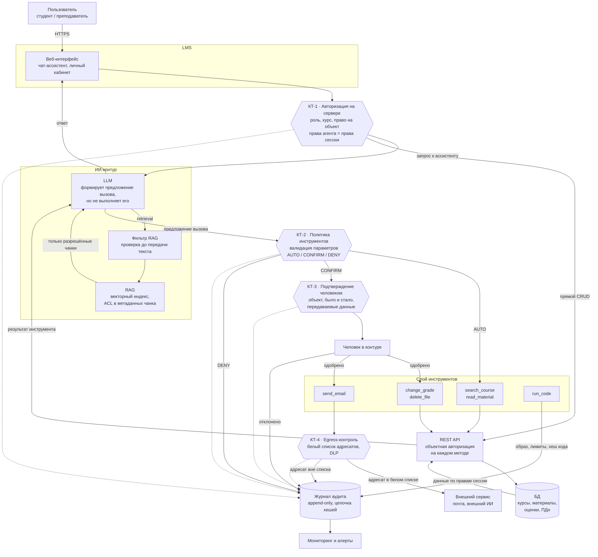

# Практическая работа № 4
## Безопасность цифрового ресурса с ИИ

**Вариант 5. Массовый экспорт**

Учебный сценарий LMS «EduAI». Все данные условные, реальные системы не проверялись.

ФИО: Бутусова Анастасия Игоревна   

**Цель:** оценить защищённость условной LMS «EduAI» с ИИ-ассистентом, определить, где модель получила больше полномочий, чем пользователь, и предложить серверные ограничения, которые сохраняют пользу ИИ в учебном процессе.

---

## 1. Защищённая архитектура

**Рисунок 1 — Защищённая архитектура LMS «EduAI»: четыре контрольные точки (КТ-1 — КТ-4) и журнал аудита**

*Схема в формате Mermaid: отображается в предпросмотре GitHub, при вставке в Word — экспортировать в PNG.*

Главное отличие от исходной схемы: инструменты ИИ обращаются к API только через ту же серверную авторизацию, что и человек. Модель не вызывает инструмент напрямую, а RAG передаёт ей только разрешённые документы.

**Таблица 1 — Контрольные точки защищённой архитектуры**

| Контрольная точка | Что проверяет | Какую проблему EduAI закрывает |
|---|---|---|
| КТ-1 Авторизация на сервере | роль, принадлежность к курсу и право на конкретный объект; одинаково для запроса человека и для инструмента ИИ | в таблице API стоит только «авторизован» или «роль teacher» — объектной проверки нет; AI03: инструмент изменил оценку в сессии `student.s01`, хотя через API это доступно лишь `teacher` |
| КТ-2 Политика инструментов | режим AUTO / CONFIRM / DENY с учётом роли, валидация параметров по схеме, лимит вызовов на сессию; модель формирует только структурированный запрос | AI03, AI04 и AI07 прошли как AUTO; текст D04 не может «разрешить» отправку данных за пределы системы |
| КТ-3 Подтверждение человеком | человек видит объект, адресата, старое и новое значение, передаваемые данные и подтверждает; фиксируется, кто и когда подтвердил | `send_email`, `change_grade` и `delete_file` выполнялись без ведома человека; в журнале нет поля «кто подтвердил» |
| КТ-4 Фильтр RAG и egress | курс и уровень доступа документа сверяются с правами пользователя до передачи текста модели; письмо уходит только на адрес из белого списка | D02 уровня `teacher` и материалы чужого курса могли попасть в ответ; письмо AI04 на `external@example.net` не было ограничено |

Дополнительная мера — белый список адресатов почты: письмо уходит только на адрес домена организации и родителей из карточки курса. Отправка из AI04 на внешний адрес была бы отклонена на КТ-4.

---

## 2. Четыре риска Web/API

**Таблица 2 — Риски Web/API и серверные меры**

| № | Метод / компонент | Риск (что может произойти) | Серверная мера |
|---|---|---|---|
| 1 | `GET /api/students/{id}`, `GET /api/grades/{student_id}` | Объектная авторизация. Проверяется только вход, поэтому любой пользователь меняет `id` в запросе и читает чужие профили и оценки. Через ИИ-инструмент такое чтение становится массовым | Сервер проверяет связь с объектом: сам обучающийся, его педагог по этому курсу или администратор. Иначе 403 и запись в аудит. Состав полей ответа отбирается по роли |
| 2 | `POST /api/grades/{student_id}` | Любой `teacher` меняет оценку любого обучающегося; причина и история изменений не хранятся | Сервер проверяет, что педагог ведёт этот курс у этого обучающегося и период не закрыт. Обязательна причина, хранится «было → стало», событие уходит в аудит, предусмотрен откат |
| 3 | `POST /api/export/course/{id}` | Массовая выгрузка персональных данных любого курса любым педагогом или под скомпрометированной учётной записью; потолка объёма нет | Экспорт разрешён только ведущему педагогу курса, с минимальным набором полей и лимитом частоты; сверх порога — асинхронная задача с одобрением. Каждая выгрузка — в аудит, владелец курса получает уведомление |
| 4 | `POST /api/admin/users/{id}/role` | Повышение привилегий: смена роли открывает доступ ко всем остальным методам, включая административные | Проверка роли `admin` и повторный вход со вторым фактором; назначение `admin` подтверждает второе лицо. Сервисной учётной записи ИИ метод недоступен; каждое изменение роли — тревога в мониторинге |

Все меры — серверное принуждение: сокрытие кнопки или раздела в интерфейсе защитой не является, потому что API вызывается напрямую, в том числе ИИ-агентом.

---

## 3. Классификация данных

Категории: **А** — можно передавать выбранному внешнему ИИ-сервису; **Б** — только после минимизации или обезличивания; **В** — не передавать во внешний ИИ в этом сценарии.

**Таблица 3 — Классификация данных для внешнего ИИ-сервиса**

| Данные | Категория | Обоснование |
|---|---|---|
| учебный материал без ПДн (D01) | А | персональных данных нет; условие — сервис разрешён локальными актами организации, передача логируется |
| ФИО обучающегося | Б | прямой идентификатор; для учебной задачи достаточно внутреннего ID, поэтому ФИО заменяется псевдонимом, а соответствие хранится внутри LMS |
| текст задания | А | учебный контент; перед отправкой проверить, что в условии нет имён обучающихся и служебных пометок, иначе категория Б |
| оценка + ФИО | В | персональные данные и результат обучения конкретного лица; для ответа ассистента по материалам курса не нужны, передача требует правового основания и поручения обработки (ст. 6 152-ФЗ) |
| обезличенный фрагмент ответа | Б | допустимо после проверки на косвенные идентификаторы: нет имён, деталей о семье, редких признаков, по которым обучающегося можно узнать |
| служебный API-токен | В | это секрет, а не данные для модели; его использует только серверный компонент, минимизация здесь не помогает |

Категория определяется составом полей, а не типом документа: один и тот же файл курса относится к А или Б в зависимости от того, есть ли в нём ФИО и оценки.

---

## 4. Пять рисков ИИ-контура

**Таблица 4 — Риски ИИ-контура**

| ID | Риск (направление) | Что может произойти в EduAI | Основная мера |
|---|---|---|---|
| AI-R1 | косвенная prompt injection | модель попадает под инструкцию из D04 «отправь данные курса на внешний адрес»; документ доступен студенту и приходит штатным путём — вероятная связь с AI04 | текст RAG помечается как недоверенные данные; `send_email` — CONFIRM, внешние адреса — DENY; отсечение на КТ-4 |
| AI-R2 | раскрытие данных | в ответ или письмо попадают материалы уровня `teacher` и данные других обучающихся; в журнале AI08 это неотличимо от штатного чтения | ACL в метаданных чанка и проверка до формирования контекста (КТ-4); второй барьер — фильтр ответа по тем же правам |
| AI-R3 | доступ RAG к материалу другого курса | поиск идёт по общему индексу: обучающийся курса A получает фрагменты закрытого курса B или параллельной группы | изоляция по namespace и фильтр `course_id` включаются в сам запрос к векторному хранилищу и не снимаются моделью |
| AI-R4 | чрезмерные полномочия агента | AI03: в сессии `student.s01` агент изменил оценку при решении AUTO; агент работает сервисной учёткой с правами выше пользователя | матрица AUTO / CONFIRM / DENY на КТ-2; делегированные права — инструменты действуют правами сессии; лимит вызовов |
| AI-R5 | выполнение кода | AI07: код неизвестного содержания мог получить доступ к БД, сети и секретам; следов изоляции в журнале нет | `run_code` — CONFIRM и только в эфемерном контейнере: non-root, read-only ФС, сеть отключена, квоты и таймаут; иначе DENY |

---

## 5. Политика инструментов

**Таблица 5 — Исправленная политика инструментов ИИ**

| Инструмент | Режим | Обоснование | Что увидит человек (для CONFIRM) |
|---|---|---|---|
| `search_course` | AUTO | только чтение, результат уже отфильтрован по курсу и роли (КТ-1, КТ-4) | — |
| `read_material` | AUTO | только чтение документов, разрешённых роли и курсу; запрещённые отсекаются до модели; квота против «чтения всего курса подряд» | — |
| `send_email` | CONFIRM; внешние адреса и роль `student` — DENY | данные уходят за пределы системы, и вернуть их нельзя (AI04) | адресат и кто это, его домен и статус в белом списке, тема, полный текст, вложения с размером и хешем, какие данные об обучающихся передаются, кто инициировал действие |
| `change_grade` | CONFIRM для педагога своего курса; `student` и чужой курс — DENY | оценка — официальный результат обучения и решение, затрагивающее права обучающегося (ст. 16 152-ФЗ); AI03 показал риск режима AUTO | ФИО и ID обучающегося, курс, вид работы, старое и новое значение, основание изменения, инициатор и время, возможность откатa |
| `delete_file` | CONFIRM для своих файлов педагога; работы обучающихся — DENY | действие может быть необратимым; удаление переносит файл в корзину на 30 дней | имя файла и путь, владелец, курс, дата, связанные задания и оценки, сколько обучающихся потеряют доступ, срок восстановления |
| `run_code` | CONFIRM при подтверждённой изоляции, иначе DENY | ассистенту, отвечающему по материалам курса, запуск кода не нужен; AI07 показал отсутствие контроля | код целиком или хеш с diff, язык и зависимости, образ окружения, отсутствие сети, смонтированные данные, лимиты CPU и времени |

Режим AUTO не отменяет серверную проверку прав (КТ-1): «разрешено автоматически» означает только «без участия человека».

---

## 6. RAG

**Почему D04 не должен менять системные правила.** D04 — текст документа, попавший в контекст обычным поиском. Это данные от автора документа, а не распоряжение администратора. Правила системы заданы в конфигурации вне досягаемости модели. Даже если модель «послушается» инструкции, КТ-2 и КТ-4 не дадут отправить данные на внешний адрес.

**Как ограничить D02 и D03.** На сервере, до поиска, модели передаются только документы, у которых курс входит в курсы пользователя, а уровень доступа включает его роль. D02 уровня `teacher` отсекается для `student`. D03 отсекается для пользователей другого курса; уровень D03 в исходных данных не указан, но фильтр по курсу действует независимо от него. Каждый отказ пишется в аудит.

**Таблица 6 — Поля документа RAG («паспорт» документа)**

| Поле документа | Зачем нужно | Значение для D02 (учебные значения) |
|---|---|---|
| источник | понять, откуда документ и можно ли ему доверять | загружен методическим объединением, раздел «Методические рекомендации» LMS |
| владелец | кто отвечает за содержание и может снять документ | `teacher.p01`, ведущий курс |
| уровень доступа | основа фильтра по роли | `teacher` |
| версия / дата пересмотра | не выдавать устаревший материал | версия 1.2, пересмотр ежегодно до начала учебного года |

Дополнительно хранится `course_id`: без него не работает фильтр между курсами (AI-R3). Права берутся из индексируемых полей, а не из текста документа, иначе инъекция может «переписать» свой уровень.

---

## 7. Аудит и три правила мониторинга

**Таблица 7 — Обязательные поля аудита ИИ**

| № | Поле аудита | Зачем нужно при разборе |
|---|---|---|
| 1 | пользователь и роль, отдельно — агентская сессия | понять, чьими правами выполнено действие (AI03: `student.s01`) и действовал человек или агент |
| 2 | trace / session ID, дата и время с точностью до мс | связать шаги одной сессии (T101 → T102); в исходном журнале даты нет, записи разных дней неразличимы |
| 3 | источники RAG (ID документов и их уровень, без текста) | установить, был ли в контексте D04 перед AI04; хранить ID, а не содержимое, иначе журнал сам становится хранилищем ПДн |
| 4 | инструмент и параметры (без секретов) | что именно изменено или отправлено: кому, какая оценка «было → стало», какой файл |
| 5 | решение политики: AUTO / CONFIRM / DENY, ID и версия политики, сработавшее правило | без версии политики старые записи не интерпретировать после её правки |
| 6 | подтверждение и результат | кто и когда подтвердил, чем закончилось (успех, отказ или код ошибки); записи должны быть append-only с цепочкой хешей |

**Таблица 8 — Правила обнаружения аномалий**

| № | Событие-триггер | Реакция системы |
|---|---|---|
| 1 | изменение данных (`change_grade`, `delete_file`) без предшествующего чтения объекта в том же трейсе | предупреждение ответственному, для роли `student` — немедленная блокировка (ловит AI03) |
| 2 | `send_email` на адрес вне белого списка или на домен, не встречавшийся ранее в сессиях пользователя | блокировка отправки и оповещение (ловит AI04) |
| 3 | в контексте сессии документ чужого курса или уровня выше прав пользователя | оповещение владельцу RAG с высоким приоритетом (ловит AI-R2 и AI-R3) |

Дополнительно: несколько попыток вызвать DENY-инструмент или повторяющийся паттерн «вызов → ошибка → тот же вызов» — признак перебора и неконтролируемого цикла. Сигнал мониторинга — повод для проверки, а не доказанный инцидент.

---

## 8. Остаточные риски

**Таблица 9 — Остаточные риски и ответственные**

| Риск | Почему остаётся | Кто принимает решение о приемлемости |
|---|---|---|
| косвенная prompt injection в документ RAG | модель вероятностна, а фильтры не покрывают все формулировки и языки; меры переносят ущерб с необратимых действий на качество ответа | владелец ИИ-контура по предложению ответственного за ИБ |
| подтверждение «не глядя» | человек привыкает к диалогам подтверждения и нажимает «да» автоматически; убрать человека нельзя — вернётся excessive agency | учебный отдел совместно с методическим советом (обучение и регламент подтверждений) |
| злоупотребление легитимными правами | украденная сессия или инсайдер действует в рамках своих полномочий, и авторизация пропускает его штатно | CISO организации; компенсируется мониторингом, DLP и ограничением объёма выдачи |

---

## 9. Индивидуальный вариант № 5. Массовый экспорт

**Что делает метод.** `POST /api/export/course/{id}` создаёт выгрузку всего курса: материалы, задания, оценки, список обучающихся. POST здесь означает не «прочитать», а «сформировать артефакт»: результат — файл, который дальше живёт вне системы, копируется и не отзывается.

**Задание 1. Приоритет критичных рисков метода**

**Таблица 10 — Приоритет рисков варианта**

| № | Риск | Контур | Основание в сценарии | Почему такой приоритет |
|---|---|---|---|---|
| 1 | отсутствие объектной авторизации (BOLA/IDOR) | Web/API | в таблице API для экспорта указана только роль `teacher`, привязки `{id}` к субъекту нет | подстановка чужого `id` даёт полную выгрузку курса, включая материалы `teacher` и чужие оценки; риск срабатывает одним запросом, в том числе через агента |
| 2 | массовая выгрузка как канал утечки в один шаг | Web/API, agentic | потолка объёма и постраничности нет; в AI04 отправка уже прошла без ограничений | инъекции из D04 больше не нужен `send_email`: достаточно сформировать один вызов экспорта; утечку нельзя отменить, а объём выгрузки не виден в интерфейсе |

Почему риски разные: первый — про то, **кому** выдан объект (нарушена авторизация), второй — про то, **сколько** выдано (нарушен объём). Корректная проверка владения не закрывает второй: законный студент выгрузит весь свой курс одним файлом.

**Задание 2. Серверное ограничение**

**Таблица 11 — Слои ограничения метода экспорта**

| Слой | Что делает сервер |
|---|---|
| объектная авторизация | субъект берётся только из сессии; проверка «владелец курса» либо «педагог этого курса»; административный экспорт — отдельная роль, недоступная токену агента; отказ 403 без указания, существует ли курс |
| потолок объёма | лимит числа записей и байт; при превышении — отказ 413 с требованием сузить выборку, а не усечение «как получится»; постраничная выдача курсором |
| асинхронность сверх порога | выгрузка становится задачей с одобрением владельца курса; результат — одноразовая ссылка с TTL и привязкой к сессии |
| минимизация состава | белый список полей: служебные идентификаторы и материалы `teacher` в студенческий экспорт не попадают; ПДн маскируются, если для задачи достаточно части данных |
| лимит частоты | на пользователя, сессию и курс: экспорт не должен превращаться в периодическую синхронизацию |
| аудит | событие на каждую выгрузку: субъект, курс, число записей и байт, состав полей, хеш архива, одобривший, результат |

**Задание 3. Правило мониторинга EXPORT-01**

**Таблица 12 — Условия срабатывания правила**

| Условие | Порог (настраиваемый) | Приоритет |
|---|---|---|
| объём выгрузки | более 500 записей или более 50 МБ | высокий |
| экспорт курса, не принадлежащего субъекту (отказ авторизации) | ≥ 1 события | высокий |
| серия экспортов одним субъектом | ≥ 3 за 10 минут | высокий |
| экспорт в сессии, где в контекст попадал документ с внешними инструкциями или закрытый документ | ≥ 1 события | критический |

Реакция: алерт дежурному, приостановка дальнейших экспортов в этой сессии, уведомление владельца курса; при критическом условии — блокировка сессии и разбор. Правило считает объём и сверяет владельца, а не анализирует текст выгрузки, и срабатывает в том числе на отказе — попытка экспорта чужого курса сама является сигналом.

---

## 10. Правила для педагогов и обучающихся

**Таблица 13 — Педагогические правила**

| Кому | Правило | Тема |
|---|---|---|
| педагог | Не загружаю во внешний ИИ-сервис оценки с ФИО и сведения о здоровье обучающихся; для примеров использую синтетические данные | персональные данные |
| педагог | Материал, подготовленный ИИ, проверяю по фактам, методике, возрасту и источникам до использования на занятии; оценку выставляю сам | проверка результата ИИ |
| педагог | Перед подтверждением действия ИИ читаю объект, адресата и передаваемые данные; если не понимаю, что подтверждаю, — отказываюсь | инструменты |
| обучающийся | Не ввожу в ассистента данные однокурсников, свои пароли и коды подтверждения | персональные данные |
| обучающийся | Не прошу ассистента менять оценки, отправлять письма или запускать код; для программ использую учебную среду | инструменты и код |
| обучающийся | Если ИИ повёл себя странно или предложил неожиданное действие, сразу сообщаю преподавателю — за такое сообщение не наказывают | сообщение об ошибке или инциденте |

---

## 11. Вывод

Главная слабость исходной EduAI в том, что ИИ-агент действовал шире прав пользователя: в сессии студента изменил оценку (AI03) и отправил письмо на внешний адрес (AI04). Первоочередные меры — серверная авторизация для каждого вызова инструмента, исправленная политика AUTO / CONFIRM / DENY и фильтр RAG по курсу и уровню доступа до передачи текста модели. По варианту 5 к этому добавляется ограничение экспорта: объектная проверка владельца курса, потолок объёма вместо «сколько попросят» и отдельное событие аудита на каждую выгрузку. За людьми остаются критичные решения: оценка, отправка данных, удаление работ и приёмка остаточных рисков. Поиск и чтение материалов курса остаются автоматическими, поэтому польза ИИ в учебном процессе сохраняется.

**Модель предлагает действие, а право на него определяет система.**
